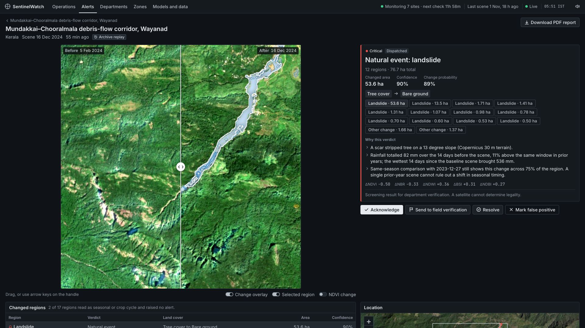

# SentinelWatch v3.0.0

SentinelWatch is a final-year engineering project for monitoring marked places in India using real Sentinel-2 imagery. An operator draws a site, chooses a catalogue-check interval, and reviews evidence of land change. The pipeline combines change segmentation, land-cover transitions, spectral indices, a same-season comparison, external context and a local permit registry. Eligible alerts are routed to the responsible department.

The strongest verdict is **“suspected unauthorised, no authorisation on record.”** Satellite imagery cannot establish illegality. Every finding needs human interpretation and, where appropriate, field verification. Seeded department addresses end in `.example`; they are illustrative destinations.

Sentinel-2 revisits a place roughly every **2–5 days**. Checking every 6, 12 or 24 hours, or weekly, polls the catalogue; it does not create a new image. Clouds can extend the wait. **Archive replay** processes real past imagery through the same pipeline and carries an explicit `archive_replay` badge.

## Screenshots

These are real, read-only captures of the first-run demo at `http://127.0.0.1:8000`, at 1920 × 1080. Each image is under 400 KB. Dates on incident images are acquisition dates; Archive replay stays visible.



| Screen | Capture |
|---|---|
| Operations | [Map, sites and live/replay alert totals](docs/screenshots/operations.jpg) |
| Wayanad | [Landslide comparison](docs/screenshots/wayanad.jpg) |
| Jewar | [Selected authorised construction region](docs/screenshots/jewar.jpg) |
| Rawa | [Suspected mining, no authorisation on record](docs/screenshots/rawa.jpg) |
| Kanha | [Site with retained findings and no alerts](docs/screenshots/kanha.jpg) |
| Alerts | [Grouped alerts and Origin filter](docs/screenshots/alerts.jpg) |
| Departments | [Inbox and separate delivery outcomes](docs/screenshots/departments.jpg) |
| Zones | [Illustrative register](docs/screenshots/zones.jpg) |
| Models | [Installed v2 and measured scores](docs/screenshots/models.jpg) |

See [capture provenance](docs/screenshots/README.md) and the [final project report PDF](output/pdf/SentinelWatch_Final_Year_Project_Report.pdf).

## Measured results

Installed change model **v2** scores **0.461 OSCD test F1** and **0.516 India forest test F1**, compared with v1's **0.248** and **0.101**. Land-cover v1 scores **0.560 accuracy**, **0.526 macro F1** and **0.373 macro IoU**. These are segmentation/reference-agreement scores, not verdict accuracy. Sources: [registry](models/registry.json), [selection](reports/ml/change_selection.json) and [test reports](reports/ml/).

The OSCD result is below the published FC-Siam-diff result of **57.92% F1 (about 0.58)** in [Daudt et al., Table 1](https://arxiv.org/html/1810.08462), which used thirteen bands; this project uses six and different preprocessing. v1's test result was seen before v2 was designed, so v2 is **not fully blind**. Out-of-fold OSCD F1 is **0.289**, and v2 test-city F1 ranges from **0.004 to 0.751**. The pooled **0.461** therefore carries real uncertainty. Land-cover scores measure agreement with **WorldCover and historical mining polygons**, not ground truth. No verdict has field validation.

The restored snapshot contains **7 sites, 14 cases and 20 grouped alerts: 3 live and 17 replay**. Headline archive results are Wayanad landslide **76.71 ha**, Jewar construction **633.41 ha**, Navi Mumbai construction **133.51 ha**, PEKB mining **53.75 ha**, Rawa mining **3.78 ha**, Kanha seasonal vegetation **1,912.63 ha** with **0 alerts**, and Delhi flood **152.93 ha**. Hectares refer only to the stated primary category/verdict, never all changed land. Jewar, PEKB and Navi also have other alerts. [Measured site table and qualifications](docs/SentinelWatch_Project_Report.md#102-measured-site-results).

Rawa is the weakest evidence, with a tile mismatch against the research dossier and uncertain attribution. Delhi is cloud-limited. PEKB's clearance is contested; a local illustrative registry match does not settle it. Wayanad's after image follows months of cloud, so this is a delayed view, not immediate detection. Research “expected” verdicts were hypotheses, not forced outputs.

## Quick start

Everything is in this repository: both trained models (`models/checkpoints/`), the saved demo data (`demo_snapshot/`) and the final report PDF (`output/pdf/`). **Training is not needed**, and neither are API keys or a `.env` file. Install Python 3.12 first. The first start also needs internet access.

The finished work is on the `feature/complete-sentinelwatch` branch, so clone that branch rather than `main`:

```sh
git clone --branch feature/complete-sentinelwatch https://github.com/srinidhimanjunath111-ni/SentinelWatch_Project.git
cd SentinelWatch_Project
```

Then start it from the repository root and open `http://127.0.0.1:8000`.

macOS/Linux:

```sh
bash scripts/run.sh
```

Windows PowerShell:

```powershell
powershell -ExecutionPolicy Bypass -File scripts\run.ps1
```

The launch script creates a virtual environment and installs the requirements plus PyTorch. On the tested Mac this took under 2 minutes, and later starts skip it. It then restores 7 sites, 14 cases and 20 alerts. No GPU is needed: the models use CUDA or Apple GPUs when present and otherwise the CPU. Imagery is cached as it is used, so the first replay of each site downloads it. Run the replays you plan to show once beforehand, as the [demo guide](docs/SentinelWatch_Demo_Guide.md) explains.

The Windows script has not been run on Windows; its control flow was only exercised with stub interpreters under PowerShell 7 on macOS.

Manual macOS/Linux setup:

```sh
python3.12 -m venv .venv
.venv/bin/python -m pip install -r requirements-operational.txt torch
cp .env.example .env
.venv/bin/python -m uvicorn app.main:app --host 127.0.0.1 --port 8000
```

Manual Windows PowerShell setup:

```powershell
py -3.12 -m venv .venv
.\.venv\Scripts\python.exe -m pip install -r requirements-operational.txt torch
Copy-Item .env.example .env
.\.venv\Scripts\python.exe -m uvicorn app.main:app --host 127.0.0.1 --port 8000
```

Copy the configuration template only on first setup; preserve an existing `.env`. Open [the console](http://127.0.0.1:8000), [health](http://127.0.0.1:8000/api/health) or [API documentation](http://127.0.0.1:8000/docs). SQLite and storage directories are created at startup. Launch commands are instructions, not a claim that Windows or Linux execution was tested here.

The operational requirements now explicitly include SciPy and ReportLab. The launch scripts attempt PyTorch installation; without a loadable model the run records its spectral fallback. Both installed checkpoints are evaluated and registered as `READY`. A clean-install restoration is recorded in `reports/demo/site_results.json`. For the authoritative training recipe, use [training/README.md](training/README.md).

## Configuration

Settings are read from environment variables and, when python-dotenv is available, `.env`. Never commit secret values. The public imagery providers do not require a personal account.

| Setting | Purpose / code default |
|---|---|
| `DATABASE_URL`, `STORAGE_DIR`, `LOG_DIR` | SQLite at `instance/sentinelwatch.db`; evidence/cache/outbox under `storage`; logs under `logs` |
| `EARTH_SEARCH_URL`, `PLANETARY_COMPUTER_URL` | Ordered public STAC providers; see `app/config.py` for endpoints |
| `COPERNICUS_CLIENT_ID`, `COPERNICUS_CLIENT_SECRET` | Optional CDSE fallback; never required for the public-provider path |
| `ENABLE_MONITORING_SCHEDULER`, `SCHEDULER_WORKERS` | Scheduled catalogue polling enabled by default; bounded worker pool |
| `DEFAULT_MONITORING_INTERVAL_MINUTES` | Default 1440; UI offers 6 h, 12 h, 24 h and weekly |
| `MONITORING_LOOKBACK_DAYS`, `MONITORING_MIN_PAIR_GAP_DAYS` | Default 180-day search; baseline at least 20 days before the later image |
| `MIN_AOI_CLEAR_FRACTION`, `MIN_PAIR_VALID_FRACTION` | Default 0.60 usable AOI coverage; 0.30 shared coverage for pair selection |
| `SEASONAL_REFERENCE_WINDOW_DAYS` | Search within 45 days either side of the date 365 days before the later scene |
| `MAX_CATCH_UP_DATES` | Default 12 recent dates retained for chronological live catch-up after an established baseline; older excess dates may be skipped and audited |
| `IMAGERY_FETCH_BUDGET_SECONDS` | Hard deadline for a remote imagery operation; production budget 120 s, isolated child can be terminated if a raster read hangs |
| `ILLUSTRATIVE_ZONE_REVIEW_BUFFER_M` | 1 km review buffer around approximate zones; flags uncertainty without extending authorisation |
| `PRELOAD_MODELS` | Background model warm-up at startup, enabled by default |
| `MAX_AOI_REQUEST_PIXELS` | Default 1024 on the longest grid side, at 10 m; split larger sites |
| `CHANGE_CHECKPOINT`, `LANDCOVER_CHECKPOINT` | Optional checkpoint overrides; expected installed paths are under `models/checkpoints/` |
| `MODEL_REGISTRY_PATH`, `SENTINELWATCH_ML_DEVICE` | Registry path; optional inference device override (`cpu`, `mps`, `cuda`) |
| `SMTP_HOST`, `SMTP_FROM`, `SMTP_PORT`, `SMTP_STARTTLS` | Real SMTP transport only when configured |
| `SMTP_USERNAME`, `SMTP_PASSWORD`, `SMTP_REDIRECT_TO` | Optional login and a controlled recipient override for a permitted email demonstration |
| `SENTINELWATCH_ADMIN_PASSWORD` | Optional login for mutating API requests; reads remain public |
| `CORS_ORIGINS` | Explicit allowed browser origins |
| `SENTINELWATCH_SEED_SITES`, `SENTINELWATCH_RESTORE_SNAPSHOT` | First-run seeding / restoration if applicable; existing evidence is not a new live observation |

The local permit registry is not connected to a comprehensive official clearance database. Records with `is_illustrative=true` have approximate boundaries and must be described as illustrative. OpenStreetMap quarry/protected-area features provide context, never permission.

## Architecture and workflow

The browser uses locally vendored Leaflet and JavaScript modules. FastAPI serves the dashboard and JSON API. SQLAlchemy stores sites, scenes, runs, analyses, cases, findings, alerts, departments, notification attempts and audit events in SQLite. A single application process owns the scheduler and Server-Sent Events bus.

1. Create a site or open a seeded site; start a check or wait for its schedule.
2. Query Earth Search, then Planetary Computer on provider failure; use CDSE only when configured. Read cropped COG windows and cache them. Each band has its own retry; remote fetches have a hard deadline.
3. Select a usable later scene, an older baseline and, if available, a same-season reference from an earlier year. Align six bands on one 10 m UTM grid; mask SCL cloud/shadow/no-data plus residual haze and buffer invalid edges.
4. Run a Siamese U-Net when loadable, combined with spectral evidence; otherwise label the spectral fallback. Classify land cover with a single-date U-Net or an explicitly recorded spectral fallback.
5. Classify connected regions, test seasonal persistence and date/type/overlap against registered zones. Store plain-language reasons and georeferenced evidence.
6. Retain seasonal findings without alerts. Group eligible regions by category and verdict, then apply duplicate merging with the same category and verdict. Live and replay remain separate, and replay merging stays within one replay ID. Route eligible alerts to a department inbox immediately; use SMTP or save an unsent `.eml` with `OUTBOX_SAVED`.
7. Review the before/after comparison, timeline, reasons, context and dispatch log. Record acknowledgement, field verification and an outcome. Download a case investigation PDF when reporting dependencies are available.

See [architecture and database diagrams](docs/diagrams/) and the [project report](docs/SentinelWatch_Project_Report.md). An alert marked `dispatched` records workflow routing; inspect its channel outcome before claiming an email was sent. SMTP `SENT` means server acceptance, not human receipt.

## Data sources

| Source | Use | Boundary |
|---|---|---|
| [Element 84 Earth Search](https://github.com/Element84/earth-search) | Primary Sentinel-2 L2A catalogue and COG assets | Public network service; availability is not guaranteed |
| [Microsoft Planetary Computer](https://planetarycomputer.microsoft.com/dataset/sentinel-2-l2a) | Public fallback catalogue and anonymously signed asset URLs | Network/signing can fail |
| [Copernicus Data Space](https://dataspace.copernicus.eu/data-collections/copernicus-sentinel-missions/sentinel-2) | Optional additional provider | Configured OAuth needed for its processing path |
| [OSCD / Daudt et al.](https://rcdaudt.github.io/oscd/) | Change-model paired imagery and urban labels | L1C domain; change-map licence is academic/noncommercial, see dataset terms |
| [Hansen Global Forest Change](https://glad.earthengine.app/view/global-forest-change) | Annual tree-loss supervision for India L2A pairs | Coarse annual labels, not exact event dates or legal findings |
| [ESA WorldCover 2021 v200](https://zenodo.org/records/7254221) | Land-cover reference labels | Model-derived labels; agreement is not field accuracy |
| [Maus et al. mining polygons v2](https://doi.pangaea.de/10.1594/PANGAEA.942325) | Mining-footprint supervision | Historical footprints, not permits or current activity |
| Open-Meteo; NASA EONET; GDACS | Rainfall and nearby disaster context | Optional; missing feeds do not prove absence of an event |
| OpenStreetMap / Overpass; Copernicus DEM | Mapped features and slope context | Incomplete context; no legal-authorisation inference |
| Local authorised-zone register | Date/type/overlap check | Coverage and provenance must be checked by a person |

Verified bibliography and source limitations are in the report. The helpers `acquire_sentinel.py` and `prepare_dataset.py` retain older metadata/RGB preparation uses; they are not the six-band training recipe below.

## Reproduce training and evaluation

Use [training/README.md](training/README.md) for the complete v1, land-cover, three-fold v2 calibration, frozen test evaluation and registry recipe. It includes the actual commands and source licences. These resource-intensive commands were not rerun for documentation and should not be started on the demo machine today.

v1 used OSCD only; v2 used OSCD plus India forest pairs, per-date median/IQR normalisation, alignment and EMA weights. The final model trained on all official OSCD training cities; its OSCD validation predictions came from folds, not a separate final-model validation set. The India datasets use geographic splits. Registry/test checkpoint hashes agree. Re-running v1 with today's sampler does not exactly reproduce its original run; the training guide names the original code revision.

Per-date normalisation can erase change covering most of the AOI. The held-out scores evaluate the networks, while alert categories/verdicts also depend on spectral and context rules. Preserve the registry, checkpoints, reports and preprocessing together.

## Deployment and verification

The repository supplies a Dockerfile and Compose file. **Docker is not installed on this documentation machine; deployment is unverified here.** The current Dockerfile installs CPU PyTorch and operational requirements and copies checkpoints, reports and the snapshot. The image has never been built here.

```sh
docker compose up --build
```

Persist `instance/` and `storage/`; preserve checkpoints, `models/registry.json` and `reports/ml/` with the release. Use one Uvicorn process for the in-process scheduler. Multiple server processes would each own a scheduler; a distributed queue/lock is future work. For a public deployment, configure the optional write login and TLS/reverse proxy, and review the deliberately public read/evidence endpoints. This is not department authentication or role-based access control.

Relevant checks for the integrator are `python -m pytest -q` and `python -m ruff check .`. This documentation task does not claim a current full-suite pass. See the [completion checklist](docs/SentinelWatch_Completion_Checklist.md) for checks actually run and pending operational evidence.

## Limits and presentation material

Clouds, mixed pixels, registration error, seasonal water/vegetation, crop timing and weak reference labels can produce missed or false detections. Upsampling SWIR bands does not add 10 m detail. A land-cover label or a burn pattern does not prove cause or intent. Inference confidence and priority are evidence-ranking heuristics, not a probability of wrongdoing. A first check starts at the newest usable scene; subsequent live checks drain newer dates chronologically within a bounded catch-up budget. Excess older dates can be skipped and audited; use replay to inspect selected past dates. The local registry is incomplete and illustrative zones remain illustrative.

Read the [10-minute demo](docs/SentinelWatch_Demo_Guide.md), [speaking guide](docs/SentinelWatch_Review_Speaking_Guide.md), [viva questions](docs/SentinelWatch_Viva_Questions.md), [v3 release notes](RELEASE_NOTES.md) and [documentation index](docs/README.md). The [final report PDF](output/pdf/SentinelWatch_Final_Year_Project_Report.pdf) includes real screenshots and rendered diagrams; the obsolete review package has been removed.


The short-pair evidence rule downgrades a proposed human activity when vegetation declines but the later spectrum still shows vegetation. It reduces seasonal browning alarms and **can miss real change on short pairs**. Map imagery deliberately has **no third-party boundary or label layer**; site outlines are local overlays, and imagery is navigation context rather than a legal map.

A roughly 75-minute window of imagery read failures was observed during overnight testing (03:34–04:48 IST). The cause is unproven. It motivated the hard fetch deadline; it is not evidence of a proven provider outage or an overnight scheduler validation.

The recorded offline proof loaded cached evidence and a case PDF, completed a cached replay, failed an unreachable-provider live operation within its shorter test budget, and recovered in the same process. The browser proof blocked external requests and still loaded all comparison layers, moved the slider and downloaded a valid case PDF. New catalogue queries and uncached imagery still need network access. See the report for measured conditions.

The recorded soak lasted **45 minutes**, with **46 samples**, **0 overview HTTP failures** and **0 logged errors**; peak RSS was **461 MB**. The scheduler ticked but no sites became due during that window. Scheduler-started checks were proved by an earlier clean-install run, not this soak. There was **no overnight scheduler run**. Docker, Windows launch, real SMTP delivery, live login and audible chime remain unverified here; verdicts have no field validation.
