# SentinelWatch monitored-site evidence dossier

Research snapshot: 1 November 2026 UTC (local date 2 November). These are **visually verified physical changes and expected demo interpretations**, not measured model performance or legal determinations. No app replay, classifier, alert dispatch or government login was run. Archive output must retain `origin = "archive_replay"`.

## Method and count definitions

Earth Search v1 was queried by POST `/search`, collection `sentinel-2-l2a`, bbox in `[west,south,east,north]`, inclusive UTC date intervals. Public COGs were read with unsigned rasterio window reads, 400 × 400 display arrays, three workers and small GDAL cache; no full Sentinel scenes were downloaded. Bands B04/B03/B02 form each true-colour preview. Fixed display scaling (reflectance / 0.32, gamma 1/1.4) is for viewing, not a quantitative product. Images are north-up in their source UTM grid; image edges approximate the stated geographic bbox. All committed JPEGs were opened and inspected by the researcher.

Radiometry caveat: Earth Search sometimes lists `offset=-0.1` after applying it to the COG. Previews honour `earthsearch:boa_offset_applied=true` and do not apply that offset twice. This follows the provider's [issue #9](https://github.com/Element84/earth-search/issues/9). [Issue #71](https://github.com/Element84/earth-search/issues/71) documents remaining anomalies even when the flag is false. Dark false-flag candidates were rejected in favour of clear same-tile scenes. This dossier does not change application radiometry.

**Replay clear count** means unique acquisition dates on the indicated canonical MGRS tile with catalogue `eo:cloud_cover <= 20%`; duplicate processings and overlapping tiles are excluded. It is a catalogue screening count, **not** a claim that every AOI in the interval was visually checked. **Recent clear count** additionally requires at least 90% AOI-valid SCL pixels on a decimated 120 × 120 grid, excluding SCL 0,1,3,8,9,10. Recent window is **4 August–1 November 2026 inclusive**, the 90 UTC dates available at this snapshot. The recent tile-screen count is also supplied; neither count proves a new change exists. Selected preview AOI validity uses a 400 × 400 SCL read. Haze, smoke and some terrain shadow can escape SCL.

Coordinates were refined from the inspected imagery; they are monitoring AOIs, not surveyed property boundaries. Each AOI is approximately 5–6 km across. All cited public links were fetched; sources unavailable through the web reader were fetched directly to temporary research storage. Source PDFs and scripts stay under `/tmp/sw-sites/`, not in the application repository.

## Verified sites

| Site | Expected verdict | Replay | Replay clear dates | Recent AOI-clear / tile-screened |
|---|---|---|---:|---:|
| Noida International Airport, Jewar | AUTHORISED_ACTIVITY | 2021-03-20 → 2025-03-24 | 153 | 7 / 7 |
| Navi Mumbai International Airport, Ulwe | AUTHORISED_ACTIVITY | 2021-01-27 → 2025-01-06 | 141 | 6 / 6 |
| Parsa East Kete Basan mine, Hasdeo Arand | AUTHORISED_ACTIVITY | 2021-02-24 → 2025-03-25 | 148 | 5 / 7 |
| Rawa–Nangal border ridge quarries | SUSPECTED_UNAUTHORISED | 2021-03-05 → 2025-03-24 | 158 | 9 / 10 |
| Mundakkai–Chooralmala debris-flow corridor, Wayanad | NATURAL_EVENT | 2024-02-05 → 2024-12-16 | 14 | 0 / 1 |
| Kanha forest–meadow seasonal reference | SEASONAL_BENIGN | 2023-11-09 → 2024-04-17 | 23 | 4 / 6 |

### Noida International Airport, Jewar

**Verified visually.** Expected `AUTHORISED_ACTIVITY`; categories: CONSTRUCTION, URBANISATION, OTHER_CHANGE.

- WGS84 bbox: `[77.585, 28.145, 77.635, 28.195]`; canonical tile `43RGM`.
- Replay: **2021-03-20 to 2025-03-24**; 153 distinct tile-screened clear dates.
- Recent 90 days: **7 AOI-clear dates** out of 7 tile-screened dates.

The 2021 patchwork of fields is replaced by a long paved runway in the northern half, large terminal roofs, graded ground and service roads in 2025. Both checked AOIs are clear. This is the strongest construction demonstration.

| Check | Scene (linked STAC record) | UTC acquisition | Tile cloud | AOI valid |
|---|---|---|---:|---:|
| Before | [S2A_43RGM_20210320_1_L2A](https://earth-search.aws.element84.com/v1/collections/sentinel-2-l2a/items/S2A_43RGM_20210320_1_L2A) | 2021-03-20T05:41:02.490000Z | 0.000033% | 100.00% |
| After | [S2B_43RGM_20250324_0_L2A](https://earth-search.aws.element84.com/v1/collections/sentinel-2-l2a/items/S2B_43RGM_20250324_0_L2A) | 2025-03-24T05:41:06.496000Z | 0.000093% | 100.00% |

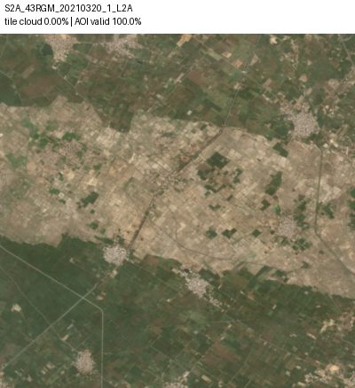

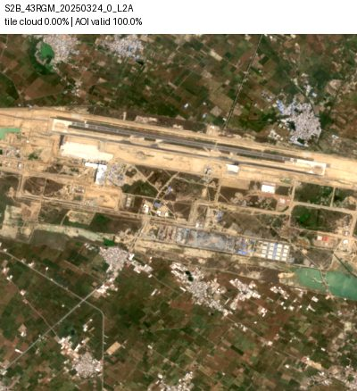

**Public record.** The fetched clearance letter is dated 9 March 2020, F.No.10-31/2018-IA-III, for Jewar airport Phase I & II. No expiry was independently established here: valid_to is null, meaning unknown, not perpetual approval.

[MoEFCC environmental clearance, 9 March 2020](https://media.niairport.in/-/jssmedia/dxn/portal/documents/environment-clearance-compliance/environment-clearance-approval.pdf).

**Limits.** The pair brackets multi-year construction, not a single-day event. Nearby fields also change with crops. Only CONSTRUCTION inside the illustrative registered platform should match the zone; the document does not establish compliance with every condition.

### Navi Mumbai International Airport, Ulwe

**Verified visually.** Expected `AUTHORISED_ACTIVITY`; categories: CONSTRUCTION, URBANISATION, WATER_CHANGE, OTHER_CHANGE.

- WGS84 bbox: `[73.045, 18.965, 73.095, 19.015]`; canonical tile `43QBB`.
- Replay: **2021-01-27 to 2025-01-06**; 141 distinct tile-screened clear dates.
- Recent 90 days: **6 AOI-clear dates** out of 6 tile-screened dates.

The 2021 view already shows a large levelled platform with perimeter roads. By 2025 a distinct east–west runway, apron and terminal roofs occupy it. The northern creek and surrounding settlements provide stable landmarks.

| Check | Scene (linked STAC record) | UTC acquisition | Tile cloud | AOI valid |
|---|---|---|---:|---:|
| Before | [S2B_43QBB_20210127_1_L2A](https://earth-search.aws.element84.com/v1/collections/sentinel-2-l2a/items/S2B_43QBB_20210127_1_L2A) | 2021-01-27T05:53:40.690000Z | 0.000411% | 100.00% |
| After | [S2B_43QBB_20250106_0_L2A](https://earth-search.aws.element84.com/v1/collections/sentinel-2-l2a/items/S2B_43QBB_20250106_0_L2A) | 2025-01-06T05:53:41.120000Z | 0.000630% | 100.00% |

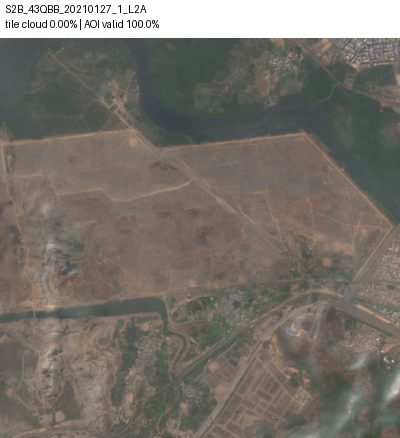

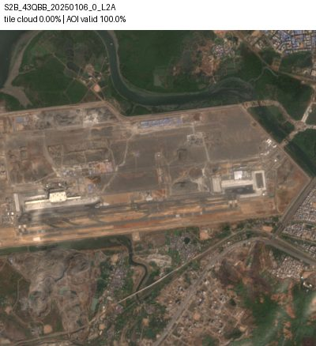

**Public record.** PIB confirms EC on 22 November 2010. The fetched 2025 compliance report, general-information table, records EC/CRZ No.21-60/2021-IA-III dated 28 November 2021, valid to 27 November 2031; its annexes reproduce the clearance. The earlier clearance was extended to 21 November 2021. The source is an operator-published public document, not an independent compliance audit.

[NMIA Environmental & CRZ compliance report, April–September 2025](https://navimumbai.adaniairports.com/-/media/Images/AdaniAirNaviMumbaiAirport/Reports/Environmental-Compliances/Half-Yearly-Environment--CRZ-Compliance-Reports/NMIAL--Half_Yearly_Compliance-Report-April-2025--Sept-2025.pdf). [PIB: Environmental clearance accorded, 22 November 2010](https://www.pib.gov.in/newsite/PrintRelease.aspx?lang=2&reg=48&relid=67416).

**Limits.** This pair demonstrates building on prepared land, not the original hill removal or mangrove reclamation. Wetland changes outside the airport platform must be judged separately. The old and renewed clearance have separate registry periods.

### Parsa East Kete Basan mine, Hasdeo Arand

**Verified visually.** Expected `AUTHORISED_ACTIVITY`; categories: MINING, DEFORESTATION, OTHER_CHANGE.

- WGS84 bbox: `[82.79, 22.805, 82.845, 22.855]`; canonical tile `44QPL`.
- Replay: **2021-02-24 to 2025-03-25**; 148 distinct tile-screened clear dates.
- Recent 90 days: **5 AOI-clear dates** out of 7 tile-screened dates.

Both dates show the characteristic curved, terraced open pit. The southern bench/overburden boundary advances into the wooded margin, while internal benches and bare surfaces change. The eastern pit end is near the right edge, not at the incorrect 82.90E location.

| Check | Scene (linked STAC record) | UTC acquisition | Tile cloud | AOI valid |
|---|---|---|---:|---:|
| Before | [S2B_44QPL_20210224_1_L2A](https://earth-search.aws.element84.com/v1/collections/sentinel-2-l2a/items/S2B_44QPL_20210224_1_L2A) | 2021-02-24T05:12:24.862000Z | 0.000073% | 100.00% |
| After | [S2B_44QPL_20250325_0_L2A](https://earth-search.aws.element84.com/v1/collections/sentinel-2-l2a/items/S2B_44QPL_20250325_0_L2A) | 2025-03-25T05:12:29.337000Z | 0.000173% | 100.00% |

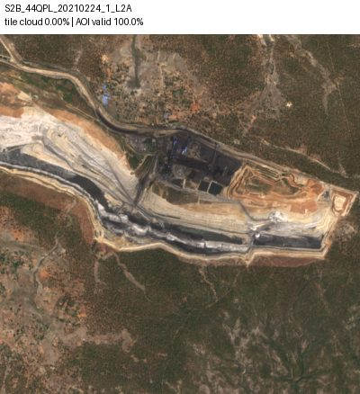

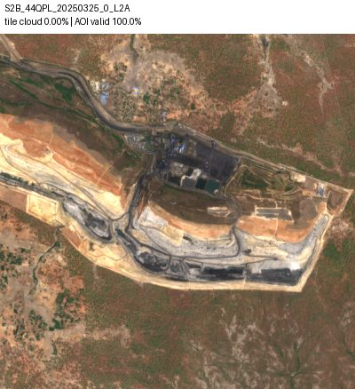

**Public record.** The Supreme Court order records MoEFCC Phase-II approval on 2 February 2022 and state permission on 25 March 2022, without deciding the merits of the High Court challenge. Correction to the brief: NGT e-Journal 2025 records disposal of OA 59/2024, 128/2024 and 133/2024 on 28 May 2025, referring to parallel court proceedings. Do not label that NGT OA ongoing; the present status of those other proceedings was not established.

[Supreme Court order, CA 4395/2014, 16 October 2023 (Indian Kanoon transcript)](https://indiankanoon.org/doc/46195082/). [NGT e-Journal 2025, pp.32–36, OA 59/2024 and connected matters](https://www.greentribunal.gov.in/sites/default/files/e-Journal_2025.pdf).

**Limits.** Authorised is a registry match, not a legal conclusion. The zone is a conservative illustrative mine footprint, not the lease or full Phase-II forest-diversion boundary. Its valid_from is the documented state permission of 25 March 2022, so early replay scenes before that date are not covered by this entry.

### Rawa–Nangal border ridge quarries

**Verified visually.** Expected `SUSPECTED_UNAUTHORISED`; categories: MINING, DEFORESTATION, OTHER_CHANGE.

- WGS84 bbox: `[77.01, 27.775, 77.065, 27.825]`; canonical tile `43RGL`.
- Replay: **2021-03-05 to 2025-03-24**; 158 distinct tile-screened clear dates.
- Recent 90 days: **9 AOI-clear dates** out of 10 tile-screened dates.

The same-tile pair shows a stripped ridge, exposed quarry strips and changing excavation surfaces, particularly the pale southern/western quarry margin. The central cleared quarry area changes shape and texture. This is a weaker visual change than the airports; a broad ridge AOI contains both worked and unworked slopes.

| Check | Scene (linked STAC record) | UTC acquisition | Tile cloud | AOI valid |
|---|---|---|---:|---:|
| Before | [S2B_43RGL_20210305_3_L2A](https://earth-search.aws.element84.com/v1/collections/sentinel-2-l2a/items/S2B_43RGL_20210305_3_L2A) | 2021-03-05T05:41:14.630000Z | 0.000005% | 100.00% |
| After | [S2B_43RGL_20250324_0_L2A](https://earth-search.aws.element84.com/v1/collections/sentinel-2-l2a/items/S2B_43RGL_20250324_0_L2A) | 2025-03-24T05:41:20.778000Z | 0.000000% | 100.00% |

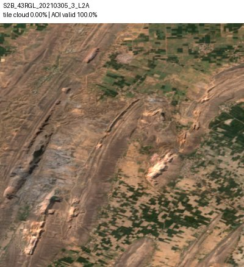

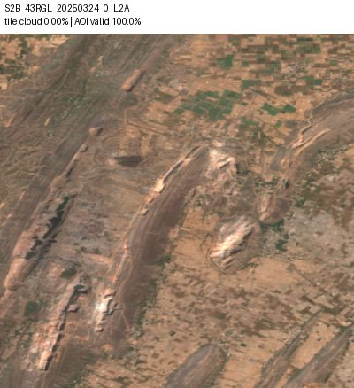

**Public record.** The Rajasthan filing, numbered page 24, gives the incident point as 27°47′59″N, 77°02′01″E (27.799722N,77.033611E), inside this bbox. It also records allotted leases in the surrounding Nangal land. The Haryana reply describes permitted mining on the Rajasthan side and reported encroachment toward Haryana. These are respondent filings, not a final finding against a named party. No lease polygon was verified, so no authorisation zone is fabricated.

[Rajasthan respondent reply in NGT OA 06/2025, incident-site coordinates](https://www.greentribunal.gov.in/sites/default/files/news_updates/Short%20Reply%20on%20behalf%20of%20R-%206%20in%20OA%20No%2006%20of%202025%20%28In%20re%20News%20item%20appearing%20in%20The%20Tribune%20dated%2012.12.2024%20titled%20Mining%20Mafia%20brings%20down%20another%20Aravalli%29.pdf). [Haryana respondent reply in NGT OA 06/2025](https://www.greentribunal.gov.in/sites/default/files/news_updates/Reply%20by%20R-1%20in%20OA%20No.%2006%20of%202025%20%28In%20re%20News%20item%20appearing%20in%20The%20Tribune%20dated%2012.12.2024%20titled%20Mining%20Mafia%20brings%20down%20another%20Aravalli%29.pdf).

**Limits.** The bbox crosses a state boundary; imagery alone cannot place individual cuts in a state or lease. The reported encroachment is too small to attribute reliably at 10 m. Nearby Rajasthan permits are explicitly documented. Never describe all visible quarrying as unauthorised. A cross-tile 2021 candidate had visibly different alignment and was rejected; only 43RGL is used for the pair.

### Mundakkai–Chooralmala debris-flow corridor, Wayanad

**Verified visually.** Expected `NATURAL_EVENT`; categories: LANDSLIDE, FLOOD, OTHER_CHANGE.

- WGS84 bbox: `[76.115, 11.45, 76.165, 11.5]`; canonical tile `43PFN`.
- Replay: **2024-02-05 to 2024-12-16**; 14 distinct tile-screened clear dates.
- Recent 90 days: **0 AOI-clear dates** out of 1 tile-screened dates.

A narrow pre-existing channel in forest/plantation becomes a broad, continuous pale debris strip running diagonally from the southwestern source area toward settlements in the northeast. The before image already contains an older scar; the 2024 event visibly widens it.

| Check | Scene (linked STAC record) | UTC acquisition | Tile cloud | AOI valid |
|---|---|---|---:|---:|
| Before | [S2B_43PFN_20240205_0_L2A](https://earth-search.aws.element84.com/v1/collections/sentinel-2-l2a/items/S2B_43PFN_20240205_0_L2A) | 2024-02-05T05:35:45.515000Z | 1.099115% | 100.00% |
| After | [S2A_43PFN_20241216_0_L2A](https://earth-search.aws.element84.com/v1/collections/sentinel-2-l2a/items/S2A_43PFN_20241216_0_L2A) | 2024-12-16T05:35:46.705000Z | 0.012369% | 100.00% |

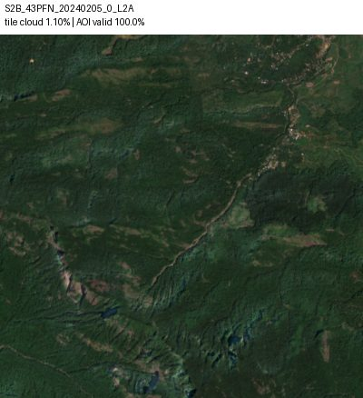

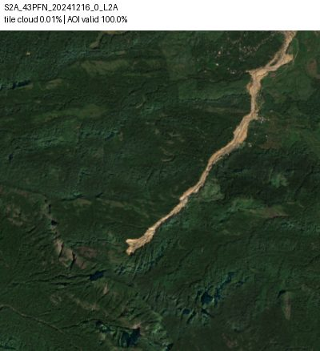

**Public record.** Yunus et al. give the crown at 11.465104N,76.134982E and the event date as 30 July 2024. Eos corroborates the rainfall-triggered channelised debris flows and notes the pre-existing 2020 channel. The source crown falls inside the verified bbox.

[Yunus et al., Documenting the Wayanad landslide](https://nora.nerc.ac.uk/id/eprint/539430/1/Documenting_Wayanad_LASL_R1.pdf). [Eos Landslide Blog, 6 August 2024](https://eos.org/thelandslideblog/wayanad-landslides).

**Limits.** The checked clear dates are 5 February and 16 December 2024: the latter is a delayed optical view, not immediate disaster detection. A 5.5 km AOI cannot contain the complete approximately 8 km runout. Do not call this Puthumala: the selected corridor is the 2024 Mundakkai–Chooralmala event, distinct from the 2019 Puthumala disaster.

### Kanha forest–meadow seasonal reference

**Verified visually.** Expected `SEASONAL_BENIGN`; categories: SEASONAL_VEGETATION, OTHER_CHANGE.

- WGS84 bbox: `[80.59, 22.265, 80.64, 22.315]`; canonical tile `44QMK`.
- Replay: **2023-11-09 to 2024-04-17**; 23 distinct tile-screened clear dates.
- Recent 90 days: **4 AOI-clear dates** out of 6 tile-screened dates.

November 2023 has a darker green canopy. April 2024 shows broad, diffuse browning rather than a newly bounded clearing. April 2023 (additional inspected reference) has the same reddish western slopes, forest/meadow margins, tracks and small waterbody. November 2024 returns to greener canopy.

| Check | Scene (linked STAC record) | UTC acquisition | Tile cloud | AOI valid |
|---|---|---|---:|---:|
| Before | [S2A_44QMK_20231109_0_L2A](https://earth-search.aws.element84.com/v1/collections/sentinel-2-l2a/items/S2A_44QMK_20231109_0_L2A) | 2023-11-09T05:22:42.767000Z | 0.223911% | 100.00% |
| After | [S2A_44QMK_20240417_0_L2A](https://earth-search.aws.element84.com/v1/collections/sentinel-2-l2a/items/S2A_44QMK_20240417_0_L2A) | 2024-04-17T05:22:46.341000Z | 0.000325% | 100.00% |

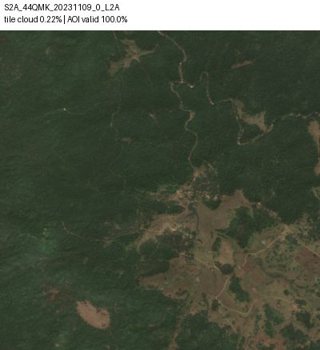

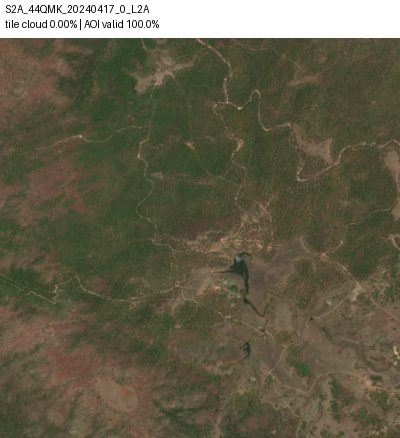

**Public record.** The state tourism page describes vegetation drying from March to June. This supports a seasonal interpretation, alongside the repeat April appearance and November regreening. No forestry-work authorisation is implied or registered.

[Madhya Pradesh Tourism: Kanha National Park, seasonal vegetation guidance](https://www.mptourism.com/destination-kanha-national-park.php).

**Limits.** This is an interior forest–meadow mosaic, not a verified buffer cadastral polygon or a pure sal stand. No conspicuous new clearing is visible in these checked views; this is not proof that none occurred between dates. Do not infer leaf loss from NDVI alone, and do not promise alert suppression until the app actually uses the same-season reference.

Additional inspected same-season dry reference: [S2A_44QMK_20230403_0_L2A](https://earth-search.aws.element84.com/v1/collections/sentinel-2-l2a/items/S2A_44QMK_20230403_0_L2A), 2023-04-03T05:22:42.578000Z, tile cloud 0.040653%, AOI valid 100.00%. Reference images are not copied, retaining the two-JPEG-per-site limit.

Additional inspected post-monsoon regreening reference: [S2A_44QMK_20241123_0_L2A](https://earth-search.aws.element84.com/v1/collections/sentinel-2-l2a/items/S2A_44QMK_20241123_0_L2A), 2024-11-23T05:22:42.452000Z, tile cloud 0.000000%, AOI valid 100.00%. Reference images are not copied, retaining the two-JPEG-per-site limit.

## Authorisation registry limitations

`app/data/authorised_zones.json` contains only authorisations supported by fetched public documents. Every polygon is **illustrative**: a conservative activity footprint traced from the selected Sentinel-2 preview, not a cadastral or official clearance polygon. Do not use these footprints as legal boundaries, and do not infer authorisation of neighbouring land or a different activity type. All vertices use GeoJSON longitude,latitude order. The per-zone `source` records the tracing date and uncertainties. Null dates mean unknown, not indefinitely valid. Navi Mumbai has separate historical and renewed EC periods.

The registry is deliberately incomplete. “No authorisation on record in this system's registry” describes this dataset, not a failed exhaustive permit search or proof of unlawful activity. The Rawa–Nangal filings explicitly mention nearby Rajasthan leases, but no verified lease polygons were obtained; no invented zone was added. PEKB has documented approval and documented litigation; see its precise case-status correction above. Registry matching must respect activity type and acquisition date.

## Integration decisions and checks still needed

- Use the proposed JSON for review; the research task does not edit `monitored_sites.json` or `seed_sites.py`. Existing sites are matched by name by the seeder; copying a changed bbox/name into the seed file does not update an existing database row. The backend owner must choose a migration/update approach.
- Run real archive replays before claiming classifier/verdict/dispatch success. Expected categories and verdicts here are research guidance, not forced labels. `NEEDS_REVIEW` must remain available when evidence or cause is insufficient; it cannot be guaranteed by choosing a real site. The four requested substantive verdict families are represented.
- The Aravalli pair is weaker than the airports and crosses a jurisdictional boundary. Keep a human review step for assigning any particular excavation to a reported incident or permit. Do not accuse a named company or person.
- Same-season evidence is essential for Kanha. The April 2023 reference was inspected; the backend must actually compare it with April 2024 before demonstrating no-alert behaviour.
- Check Earth Search offset handling in the application separately. This research changed no model, inference or imagery-service code.
